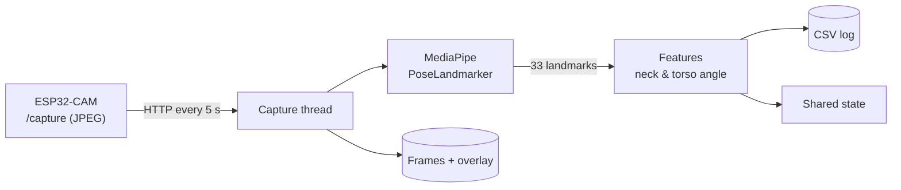

# ErgonomAI

> Sitting posture monitor: an ESP32-CAM takes a side-view photo every 5 s, MediaPipe Pose finds ear–shoulder–hip, and Python turns it into a neck angle that is logged and (soon) shown live in the browser.


## How it works



- **Pose detection.** MediaPipe Tasks API in `IMAGE` mode. The model is loaded once and every frame is processed independently.
- **Angles in pixels.** Normalized landmarks use different scales for x (width) and y (height), so they are converted to pixels before `atan2`. The sign is corrected for the direction the person is facing.
- **Side selection.** From a side view MediaPipe reports ~0.98 visibility for both sides. Ties are broken by shoulder depth (z): the closer side wins.
- **Honest logging.** Every attempt writes a CSV row, including failures (`no_frame`, `no_person`, `low_visibility`, `error`), so the share of reliable data can be measured. Each row is `flush` + `fsync`'d.
- **Drift-free timing.** Ticks are scheduled from the start time, not from the end of the previous frame.

## Project structure

| File | Responsibility |
|---|---|
| `detection.py` | Model loading, JPEG decoding, pose detection |
| `features.py` | Side selection, pixel conversion, neck/torso angles |
| `csv_logger.py` | Append-only, crash-safe CSV logging |
| `state.py` | Thread-safe shared state (copy-on-write snapshots) |
| `monitor.py` | Capture thread: HTTP → pose → features → CSV + state |

## Getting started

**Requirements:** Python 3.14 and an ESP32-CAM running the `CameraWebServer` example with frame size set to VGA (640×480).

```powershell
git clone https://github.com/<your-login>/ErgonomAI.git
cd ErgonomAI
python -m venv .venv
.venv\Scripts\Activate.ps1
pip install -r requirements.txt

# Pose model (5.8 MB) from the official MediaPipe model storage
Invoke-WebRequest https://storage.googleapis.com/mediapipe-models/pose_landmarker/pose_landmarker_lite/float16/latest/pose_landmarker_lite.task -OutFile pose_landmarker_lite.task
```

Run:

```powershell
python monitor.py http://<ESP32_IP>/capture   # options: --interval 5 --out data
```

Stop with `Ctrl+C`. The capture thread finishes its current frame and closes the CSV cleanly.

Output goes to `data/posture_log.csv` and `data/frames/YYYY-MM-DD/`. A debug overlay is saved for every 10th detection.

## CSV format

| Column | Meaning |
|---|---|
| `timestamp` | ISO 8601 with timezone |
| `status` | `ok` / `low_visibility` / `no_person` / `no_frame` / `error` |
| `side` | Body side facing the camera (`left` / `right`) |
| `neck_angle` | Ear-over-shoulder deviation from vertical in degrees, `+` = head forward. Empty when unreliable, never a fake `0` |
| `torso_angle` | Shoulder-over-hip deviation from vertical in degrees |
| `vis_ear`, `vis_shoulder`, `vis_hip` | MediaPipe visibility of the chosen landmarks |
| `image_file` | Relative path to the saved frame |

## Privacy

Camera frames never leave your machine. `data/` is git-ignored and the planned web server binds to `127.0.0.1` by default.
