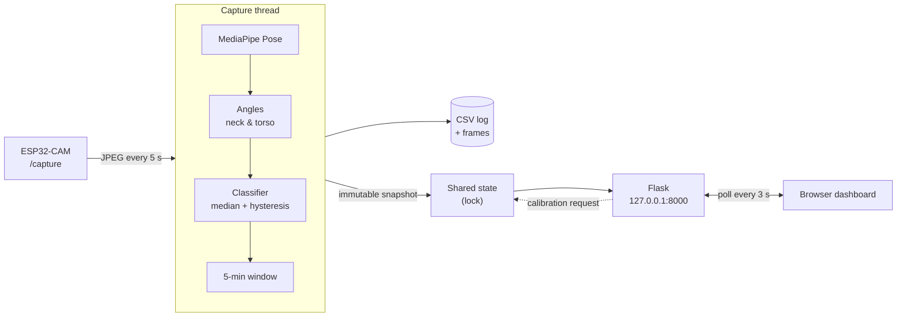

# ErgonomAI

> Sitting posture monitor: an ESP32-CAM takes a side-view photo every 5 s, MediaPipe Pose finds ear–shoulder–hip, and a local web dashboard tells you when you start slouching, measured against your own calibrated posture.


## Features

- **Live dashboard.** Shows the latest frame with a skeleton overlay, a large posture verdict, angles and frame age. Works on desktop and phone, on your machine only.
- **Personal calibration.** Sit straight for 30 s and the median of 6 valid measurements becomes your baseline. The baseline survives restarts.
- **Stable verdict.** Median smoothing and hysteresis (alert at +12°, clear below +8°) keep measurement noise from making the verdict flicker.
- **5-minute statistics.** Reports the share of time spent slouching, counted from valid samples only, with an explicit "not enough data" state.
- **Honest logging.** Every attempt writes one CSV row, including failures. Raw frames are kept as a future training dataset.
- **Private by default.** No cloud. The server binds to `127.0.0.1` and camera data is git-ignored.

## How it works



## Design decisions

### Vision

- **Pose model.** MediaPipe Tasks API in `IMAGE` mode. The model is loaded once and every frame is processed independently.
- **Angles in pixels.** Normalized landmarks use different scales for x (image width) and y (image height). Calling `atan2` on raw values would distort every angle, so landmarks are converted to pixels first.
- **Facing direction.** The angle sign is corrected using the nose-vs-ear position, so the camera can stand on either side of the desk.
- **Side selection.** From a side view MediaPipe reports ~0.98 visibility for *both* sides, because it infers the hidden one. Near-ties are therefore broken by shoulder depth (z): the side closer to the camera wins.
- **Empty, not zero.** Unreliable measurements are stored as empty values, never as `0`. A zero would claim "perfectly straight".

### Classification

- **Outlier-resistant smoothing.** The smoothed angle is `median_low` over the last 3 valid samples. A single outlier cannot trigger an alert, even right after start-up: with only 2 values in the buffer, plain `median` would average them.
- **Hysteresis.** The dead band (8–12° above baseline) is wider than the per-frame noise, so the verdict only changes on a real change in posture.
- **Special states.** No person, no frame and low visibility skip the state machine instead of resetting it.
- **Coverage.** In the 5-minute window, valid samples are counted against the *expected* number of samples (300 s / 5 s). Two samples after start-up count as 3% coverage, not 100%.

### Concurrency and robustness

- **One process, two threads.** The capture thread is the only code that talks to the ESP32, and it alone owns the classifier and the rolling window, so they need no locks. Flask only reads immutable snapshots (copy-on-write under a lock) and leaves a calibration *request* flag that the capture thread consumes atomically.
- **The reader judges freshness.** Frame age and the stale-frame verdict are computed at request time, because a hung producer cannot report that it is hung.
- **Drift-free sampling.** Ticks are scheduled from the start time on a monotonic clock. A `threading.Event` wakes the thread instantly on `Ctrl+C`, so the CSV is closed cleanly.
- **No fatal iterations.** An error in one iteration cannot kill the capture thread: it becomes an `error` row plus a traceback in the log.
- **Crash-safe files.** Every CSV row is flushed and `fsync`'d. When the CSV schema changes, the old file is archived, never rewritten. `baseline.json` is written atomically (temp file + `os.replace`).
- **No reloader.** Flask's reloader is disabled, because it would start a second capture thread writing to the same CSV.

## Project structure

| File | Responsibility |
|---|---|
| `config.py` | All tunable parameters: camera, server, thresholds, paths |
| `detection.py` | Model loading, JPEG decoding, pose detection |
| `features.py` | Side selection, pixel conversion, neck/torso angles |
| `classifier.py` | Calibration, median smoothing, hysteresis, baseline persistence |
| `window_stats.py` | Rolling 5-minute statistics |
| `state.py` | Thread-safe shared state (copy-on-write snapshots) |
| `csv_logger.py` | Append-only, crash-safe CSV with schema rotation |
| `monitor.py` | Capture thread; also a headless mode (console + CSV) |
| `server.py` | Flask server and the main entry point |
| `templates/index.html` | Dashboard: a single file with inline CSS/JS and no frameworks |

## Getting started

**Requirements:** Python 3.14 and an ESP32-CAM running the `CameraWebServer` example with frame size set to VGA (640×480).

```powershell
git clone https://github.com/<your-login>/ErgonomAI.git
cd ErgonomAI
python -m venv .venv
.venv\Scripts\Activate.ps1
pip install -r requirements.txt

# Pose model (5.8 MB) from the official MediaPipe model storage
Invoke-WebRequest https://storage.googleapis.com/mediapipe-models/pose_landmarker/pose_landmarker_lite/float16/latest/pose_landmarker_lite.task -OutFile pose_landmarker_lite.task
```

Set `ESP32_URL` in `config.py` to the address the board prints on the Serial Monitor. Then run:

```powershell
python server.py    # dashboard at http://127.0.0.1:8000
python monitor.py   # headless: console + CSV only
```

Both commands also accept the camera URL as an optional first argument. Stop either one with `Ctrl+C`.

**First use:** sit straight and click **„Kalibruj (siedź prosto 30 s)”** ("Calibrate: sit straight for 30 s").

### Dashboard verdicts

The interface is in Polish:

| Label | Meaning |
|---|---|
| **OK** (green) | Posture within your calibrated range |
| **Garbisz się!** (red) | "You're slouching!" The smoothed neck angle is more than 12° above baseline. The alert stays on until the angle drops below +8° |
| Brak kalibracji | No baseline yet: calibrate first |
| Kalibracja… | Calibration in progress (x/6 valid samples) |
| Brak osoby | No person in the frame |
| Brak obrazu | No frame, or the last frame is older than 15 s |
| Niepewny pomiar | Ear or shoulder visibility is below the threshold |

## HTTP API

| Endpoint | Description |
|---|---|
| `GET /` | Dashboard |
| `GET /api/state` | JSON snapshot: measurement, verdict, baseline, delta, 5-minute stats, frame age |
| `GET /frame.jpg` | Latest frame with overlay. Sent with `Cache-Control: no-store`. Returns `503` before the first frame |
| `POST /api/calibrate` | Starts calibration and returns `202`. Requires `Content-Type: application/json`, which blocks cross-site "simple" requests (CSRF) |

## Configuration

All parameters live in `config.py`. The most important ones:

| Parameter | Default | Meaning |
|---|---|---|
| `ESP32_URL` | — | Camera snapshot endpoint |
| `CAPTURE_INTERVAL` | `5.0` s | Time between frames |
| `HOST`, `PORT` | `127.0.0.1`, `8000` | Server address (local only) |
| `CALIBRATION_SAMPLES` | `6` | Valid samples used for the baseline |
| `SLOUCH_ENTER_DELTA` / `SLOUCH_EXIT_DELTA` | `12°` / `8°` | Hysteresis thresholds above baseline |
| `SMOOTHING_WINDOW` | `3` | Median window, in valid samples |
| `WINDOW_S` / `WINDOW_MIN_VALID` | `300` s / `50%` | Statistics window and its minimum coverage |
| `FRAME_STALE_AFTER` | `15` s | Age at which a frame counts as "no frame" |
| `MIN_VIS` | `0.6` | Minimum landmark visibility for a valid angle |

## Output

- `data/posture_log.csv`: one row per attempt.
- `data/frames/YYYY-MM-DD/*.jpg`: raw frames, plus an `_overlay.jpg` for every 10th detection.
- `baseline.json`: your calibration.

| Column | Meaning |
|---|---|
| `timestamp` | ISO 8601 with timezone |
| `status` | Measurement: `ok` / `low_visibility` / `no_person` / `no_frame` / `error` |
| `side` | Body side facing the camera (`left` / `right`) |
| `neck_angle` | Ear-over-shoulder deviation from vertical in degrees, `+` = head forward. Empty when unreliable |
| `torso_angle` | Shoulder-over-hip deviation from vertical in degrees |
| `vis_ear`, `vis_shoulder`, `vis_hip` | MediaPipe visibility of the chosen landmarks |
| `image_file` | Relative path to the saved frame |
| `smoothed_angle` | Median of the last 3 valid neck angles. Empty when the current sample is not valid |
| `delta` | `smoothed_angle − baseline` |
| `verdict` | `ok` / `slouching` / `no_baseline` / `calibrating` / `no_person` / `no_frame` / `low_visibility` / `error` |

## Privacy

- Camera frames never leave your machine. There is no cloud service and the server binds to `127.0.0.1` by default.
- `data/` and `baseline.json` are git-ignored.
- The calibration endpoint rejects cross-site requests from other pages open in your browser.
